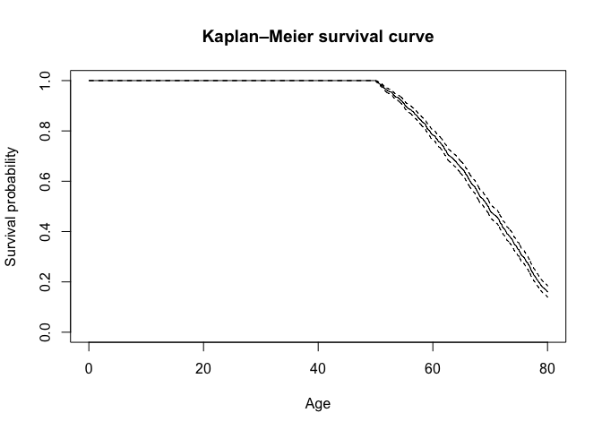
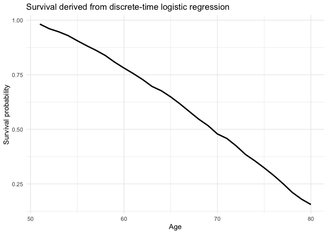
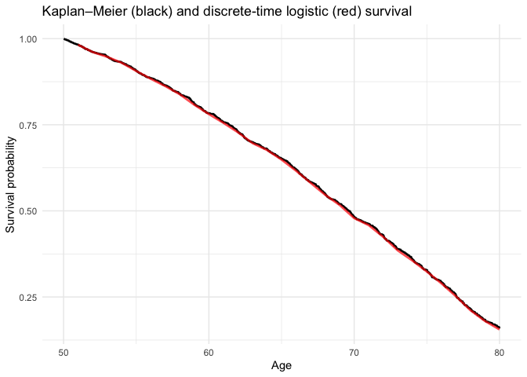
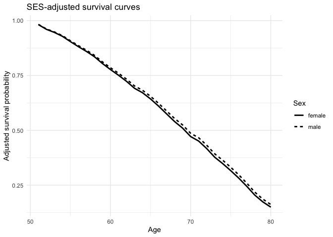
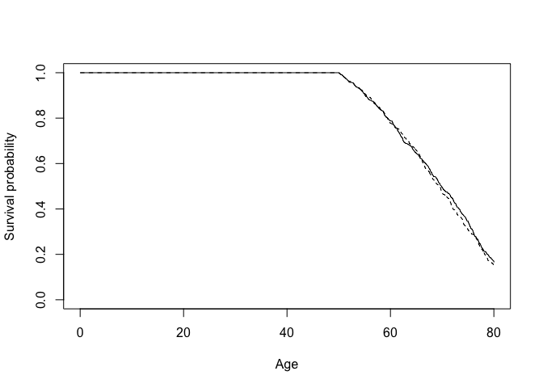

- [Introduction](#introduction)
  - [Setup](#setup)
- [Survival and the hazard](#survival-and-the-hazard)
- [Kaplan–Meier survival](#kaplanmeier-survival)
- [Person-Period files](#person-period-files)
- [Discrete-time EHA using logistic regression](#discrete-time-eha-using-logistic-regression)
  - [First model: the baseline hazard only](#first-model-the-baseline-hazard-only)
  - [Predicted hazards using `marginaleffects`](#predicted-hazards-using-marginaleffects)
  - [From predicted hazards back to survival](#from-predicted-hazards-back-to-survival)
  - [Comparing logistic regression with Kaplan–Meier](#comparing-logistic-regression-with-kaplanmeier)
  - [Adding covariates](#adding-covariates)
  - [Why adjusted survival curves?](#why-adjusted-survival-curves)
  - [Creating counterfactual prediction data](#creating-counterfactual-prediction-data)
  - [Predicting adjusted hazards with `marginaleffects`](#predicting-adjusted-hazards-with-marginaleffects)
  - [From adjusted hazards to adjusted survival](#from-adjusted-hazards-to-adjusted-survival)
  - [Unadjusted versus adjusted group differences](#unadjusted-versus-adjusted-group-differences)
  - [Comparing probabilities directly with `marginaleffects`](#comparing-probabilities-directly-with-marginaleffects)
  - [Differences at particular ages](#differences-at-particular-ages)
- [Modeling the baseline hazard differently](#modeling-the-baseline-hazard-differently)
  - [Logit versus complementary log-log](#logit-versus-complementary-log-log)
- [The logic of the analysis](#the-logic-of-the-analysis)

# Introduction

This tutorial introduces the basics of event history analysis (EHA)/survival analysis using the `scania` dataset from the `eha` package to study mortality after age 50.

The main idea is to approach the same survival process in two ways. We first estimate survival non-parametrically using Kaplan–Meier (i.e., we do not impose a functional form on the survival process and just examine what the raw data shows). We then restructure the data into person-period format and estimate the age-specific hazard using logistic regression. From those predicted hazards we reconstruct a survival curve and compare it directly with Kaplan–Meier.

After establishing this connection do we add explanatory variables and calculate adjusted survival curves.

## Setup

Install the packages if necessary:

``` r
install.packages(c(
  "eha",
  "survival",
  "dplyr",
  "tidyr",
  "ggplot2",
  "marginaleffects"
))
```

Load the packages:

``` r
library(eha)
library(survival)
library(dplyr)
library(tidyr)
library(ggplot2)
library(marginaleffects)
```

Load the Scania data:

``` r
data(scania)

head(scania)
```

        id enter   exit event birthdate    sex parish   ses immigrant
    29   1    50 59.242     1  1781.454   male      1 lower        no
    66   2    50 53.539     0  1821.350   male      1 lower       yes
    70   3    50 62.155     1  1788.936   male      1 lower       yes
    83   4    50 65.142     1  1796.219 female      1 lower       yes
    100  5    50 51.280     0  1822.713   male      1 lower       yes
    132  6    50 70.776     1  1813.547 female      1 lower       yes

``` r
summary(scania)
```

           id             enter         exit           event          birthdate   
     Min.   :   1.0   Min.   :50   Min.   :50.00   Min.   :0.0000   Min.   :1763  
     1st Qu.: 483.5   1st Qu.:50   1st Qu.:55.37   1st Qu.:0.0000   1st Qu.:1786  
     Median : 966.0   Median :50   Median :62.70   Median :1.0000   Median :1808  
     Mean   : 966.0   Mean   :50   Mean   :63.97   Mean   :0.5624   Mean   :1806  
     3rd Qu.:1448.5   3rd Qu.:50   3rd Qu.:72.05   3rd Qu.:1.0000   3rd Qu.:1825  
     Max.   :1931.0   Max.   :50   Max.   :80.00   Max.   :1.0000   Max.   :1845  
         sex      parish      ses       immigrant 
     male  :975   1: 159   upper: 375   no : 759  
     female:956   2: 181   lower:1556   yes:1172  
                  3: 180                          
                  4: 258                          
                  5:1153                          
                                                  

The most important variables include:

- `id`: person identifier
- `enter`: age at which observation begins
- `exit`: age at death or censoring
- `event`: whether death occurred at `exit`
- `sex`: sex
- `ses`: socioeconomic status

In these data, observation starts at age 50.

Suppose a person has:

``` text
enter = 50
exit  = 59.24
event = 1
```

This means that the person is observed from age 50 and dies at age 59.24.

If instead:

``` text
enter = 50
exit  = 80
event = 0
```

the person is observed until age 80 but does not die while under observation. The observation is **right-censored**.

# Survival and the hazard

Two quantities are central to event history analysis.

The **survival function**

$$
S(t)=P(T>t)
$$

gives the probability of remaining event-free beyond time $t$.

In our example:

> What is the probability that somebody who has reached age 50 survives beyond age 50?

The **hazard** asks a different question. In discrete time:

$$
h_j =
P(\text{death in interval }j
\mid
\text{alive at the beginning of interval }j).
$$

For example:

> Among people who are alive at age 70, what is the probability that they die between ages 70 and 71?

The two quantities are directly connected.

If the hazards in successive intervals are

$$
h_1,h_2,\ldots,h_j,
$$

then survival through interval $j$ is

$$
S_j =
\prod_{k=1}^{j}(1-h_k).
$$

This relationship will become important when we estimate the hazard with logistic regression.

# Kaplan–Meier survival

We begin with the Kaplan–Meier estimator.

Create a survival object:

``` r
surv <- Surv(
  time = scania$enter,
  time2 = scania$exit,
  event = scania$event
)
```

Because we specify both entry and exit time, this takes the form

``` r
Surv(enter, exit, event)
```

and describes the period during which each person is at risk.

Estimate overall survival:

``` r
km <- survfit(
  surv ~ 1,
  data = scania
)

km
```

    Call: survfit(formula = surv ~ 1, data = scania)

            n events median 0.95LCL 0.95UCL
    [1,] 1931   1086   69.6    68.9    70.4

Plot the survival curve:

``` r
plot(
  km,
  xlab = "Age",
  ylab = "Survival probability",
  main = "Kaplan–Meier survival curve"
)
```



The curve starts at 1 at age 50 and declines as deaths occur.

We can request survival probabilities at selected ages:

``` r
summary(
  km,
  times = c(60, 70, 80)
)
```

    Call: survfit(formula = surv ~ 1, data = scania)

     time n.risk n.event survival std.err lower 95% CI upper 95% CI
       60   1129     352    0.783  0.0103        0.763        0.804
       70    578     395    0.483  0.0136        0.457        0.510
       80    146     339    0.159  0.0113        0.139        0.183

For example, the survival probability at age 70 answers:

> Among people who survived to age 50, what proportion are estimated to survive to at least age 70?

Kaplan–Meier estimates this directly from the observed survival times. We have not yet specified a regression model.

# Person-Period files

To estimate a **discrete-time event history model**, we restructure the data.

The original data have one row per person.

For discrete-time analysis we instead want one row for every time interval during which a person is at risk.

We will use one-year age intervals.

Someone who dies at age 55.4 will therefore contribute observations approximately like:

``` text
id    age    death
1      50      0
1      51      0
1      52      0
1      53      0
1      54      0
1      55      1
```

The variable `death` now indicates whether the event occurs **during that particular interval**.

Thus:

- `death = 0` means that the person survives the interval.
- `death = 1` means that the person dies during the interval.

Create the person-period data:

``` r
scania_pp <- scania |>
  mutate(
    event = as.integer(event),
    n_intervals = if_else(
      event == 1,
      ceiling(exit) - 50,
      floor(exit) - 50
    )
  ) |>
  filter(n_intervals > 0) |>
  uncount(
    n_intervals,
    .id = "period",
    .remove = FALSE
  ) |>
  mutate(
    age = 49 + period,
    death = as.integer(
      event == 1 &
        period == n_intervals
    )
  )
```

Inspect the resulting file:

``` r
scania_pp |>
  select(id, age, death, sex, ses) |>
  head(20)
```

       id age death  sex   ses
    1   1  50     0 male lower
    2   1  51     0 male lower
    3   1  52     0 male lower
    4   1  53     0 male lower
    5   1  54     0 male lower
    6   1  55     0 male lower
    7   1  56     0 male lower
    8   1  57     0 male lower
    9   1  58     0 male lower
    10  1  59     1 male lower
    11  2  50     0 male lower
    12  2  51     0 male lower
    13  2  52     0 male lower
    14  3  50     0 male lower
    15  3  51     0 male lower
    16  3  52     0 male lower
    17  3  53     0 male lower
    18  3  54     0 male lower
    19  3  55     0 male lower
    20  3  56     0 male lower

We can also inspect one person who dies:

``` r
example_id <- scania_pp |>
  filter(death == 1) |>
  slice(1) |>
  pull(id)

scania_pp |>
  filter(id == example_id) |>
  select(id, age, death)
```

       id age death
    1   1  50     0
    2   1  51     0
    3   1  52     0
    4   1  53     0
    5   1  54     0
    6   1  55     0
    7   1  56     0
    8   1  57     0
    9   1  58     0
    10  1  59     1

There are multiple observations for this person but only one event, in the final interval.

# Discrete-time EHA using logistic regression

We now estimate the same mortality process using logistic regression.

Because each row represents one interval during which a person is at risk, our dependent variable is

$$
P(death_{it}=1).
$$

More precisely, the model estimates

$$
P(
\text{death during interval }t
\mid
\text{alive at the start of interval }t
).
$$

This is the **discrete-time hazard**.

## First model: the baseline hazard only

Before adding explanatory variables such as sex or socioeconomic status, we estimate a model containing only **age**.

For the first model, it is useful to treat age as categorical:

``` r
m0 <- glm(
  death ~ factor(age),
  data = scania_pp,
  family = binomial(link = "logit")
)

summary(m0)
```


    Call:
    glm(formula = death ~ factor(age), family = binomial(link = "logit"), 
        data = scania_pp)

    Coefficients:
                  Estimate Std. Error z value Pr(>|z|)    
    (Intercept)   -4.01173    0.17562 -22.843  < 2e-16 ***
    factor(age)51  0.19634    0.24028   0.817 0.413875    
    factor(age)52 -0.20900    0.27034  -0.773 0.439455    
    factor(age)53  0.02659    0.25682   0.104 0.917552    
    factor(age)54  0.37212    0.23908   1.557 0.119588    
    factor(age)55  0.34960    0.24358   1.435 0.151228    
    factor(age)56  0.31006    0.24878   1.246 0.212660    
    factor(age)57  0.44690    0.24374   1.834 0.066719 .  
    factor(age)58  0.73585    0.23217   3.169 0.001528 ** 
    factor(age)59  0.64621    0.23952   2.698 0.006977 ** 
    factor(age)60  0.61984    0.24404   2.540 0.011088 *  
    factor(age)61  0.73260    0.24114   3.038 0.002381 ** 
    factor(age)62  0.91227    0.23483   3.885 0.000102 ***
    factor(age)63  0.49083    0.26263   1.869 0.061637 .  
    factor(age)64  0.86804    0.24297   3.573 0.000353 ***
    factor(age)65  1.06229    0.23643   4.493 7.02e-06 ***
    factor(age)66  1.20233    0.23325   5.155 2.54e-07 ***
    factor(age)67  1.25633    0.23455   5.356 8.50e-08 ***
    factor(age)68  1.15495    0.24377   4.738 2.16e-06 ***
    factor(age)69  1.48080    0.23305   6.354 2.10e-10 ***
    factor(age)70  0.90007    0.27270   3.301 0.000965 ***
    factor(age)71  1.48703    0.24195   6.146 7.94e-10 ***
    factor(age)72  1.73214    0.23642   7.326 2.36e-13 ***
    factor(age)73  1.51389    0.25429   5.953 2.63e-09 ***
    factor(age)74  1.70036    0.25134   6.765 1.33e-11 ***
    factor(age)75  1.87335    0.25056   7.477 7.63e-14 ***
    factor(age)76  2.10805    0.24714   8.530  < 2e-16 ***
    factor(age)77  2.36307    0.24627   9.595  < 2e-16 ***
    factor(age)78  2.25964    0.26449   8.543  < 2e-16 ***
    factor(age)79  2.16362    0.28490   7.594 3.10e-14 ***
    ---
    Signif. codes:  0 '***' 0.001 '**' 0.01 '*' 0.05 '.' 0.1 ' ' 1

    (Dispersion parameter for binomial family taken to be 1)

        Null deviance: 9121.7  on 27177  degrees of freedom
    Residual deviance: 8685.2  on 27148  degrees of freedom
    AIC: 8745.2

    Number of Fisher Scoring iterations: 6

Why use `factor(age)`?

Because we do not yet want to impose a particular shape on the baseline hazard.

Instead, the model estimates a separate mortality probability for each age interval.

Conceptually, this model is estimating

$$
h_{50}, h_{51}, h_{52}, \ldots
$$

where, for example, $h_{70}$ is the probability of dying between approximately age 70 and 71 among people who are alive at age 70.

## Predicted hazards using `marginaleffects`

The coefficients from a logistic regression are expressed as log odds.

Those are usually not the most useful quantities for interpretation.

We can instead use `marginaleffects` to obtain predicted probabilities.

``` r
hazard0 <- predictions(
  m0,
  newdata = datagrid(
    age = sort(unique(scania_pp$age))
  ),
  type = "response"
)

hazard0
```


     age Estimate Std. Error    z Pr(>|z|)    S   2.5 % 97.5 %
      50   0.0178    0.00307 5.80   <0.001 27.1 0.01177 0.0238
      51   0.0216    0.00346 6.23   <0.001 31.0 0.01478 0.0283
      52   0.0145    0.00293 4.94   <0.001 20.3 0.00873 0.0202
      53   0.0183    0.00336 5.44   <0.001 24.1 0.01167 0.0248
      54   0.0256    0.00404 6.33   <0.001 31.9 0.01766 0.0335
      55   0.0250    0.00412 6.08   <0.001 29.6 0.01696 0.0331
      56   0.0241    0.00414 5.82   <0.001 27.3 0.01597 0.0322
      57   0.0275    0.00452 6.08   <0.001 29.7 0.01866 0.0364
      58   0.0364    0.00533 6.83   <0.001 36.8 0.02597 0.0468
      59   0.0334    0.00526 6.35   <0.001 32.1 0.02309 0.0437
      60   0.0325    0.00534 6.10   <0.001 29.8 0.02209 0.0430
      61   0.0363    0.00578 6.28   <0.001 31.5 0.02497 0.0476
      62   0.0431    0.00643 6.70   <0.001 35.5 0.03052 0.0557
      63   0.0287    0.00545 5.27   <0.001 22.8 0.01805 0.0394
      64   0.0413    0.00665 6.21   <0.001 30.8 0.02830 0.0544
      65   0.0498    0.00749 6.65   <0.001 35.0 0.03509 0.0644
      66   0.0568    0.00823 6.91   <0.001 37.6 0.04070 0.0729
      67   0.0598    0.00874 6.84   <0.001 36.9 0.04265 0.0769
      68   0.0543    0.00869 6.26   <0.001 31.2 0.03731 0.0714
      69   0.0737    0.01046 7.05   <0.001 39.0 0.05322 0.0942
      70   0.0426    0.00851 5.01   <0.001 20.8 0.02594 0.0593
      71   0.0741    0.01142 6.49   <0.001 33.4 0.05175 0.0965
      72   0.0928    0.01333 6.96   <0.001 38.1 0.06670 0.1190
      73   0.0760    0.01292 5.88   <0.001 27.9 0.05069 0.1013
      74   0.0902    0.01475 6.11   <0.001 29.9 0.06127 0.1191
      75   0.1054    0.01685 6.25   <0.001 31.2 0.07239 0.1385
      76   0.1297    0.01963 6.61   <0.001 34.6 0.09122 0.1682
      77   0.1613    0.02336 6.91   <0.001 37.5 0.11551 0.2071
      78   0.1478    0.02491 5.93   <0.001 28.3 0.09896 0.1966
      79   0.1361    0.02638 5.16   <0.001 21.9 0.08440 0.1878

    Type: response

The variable `estimate` now contains the estimated probability of dying during each age interval.

``` r
hazard0 |>
  as.data.frame() |>
  select(age, estimate)
```

       age   estimate
    1   50 0.01778017
    2   51 0.02155417
    3   52 0.01447528
    4   53 0.01825047
    5   54 0.02559055
    6   55 0.02503477
    7   56 0.02408759
    8   57 0.02752294
    9   58 0.03640777
    10  59 0.03339041
    11  60 0.03254973
    12  61 0.03629417
    13  62 0.04312939
    14  63 0.02872340
    15  64 0.04134078
    16  65 0.04976303
    17  66 0.05681818
    18  67 0.05978261
    19  68 0.05433186
    20  69 0.07371795
    21  70 0.04262877
    22  71 0.07414449
    23  72 0.09282700
    24  73 0.07600950
    25  74 0.09018568
    26  75 0.10542169
    27  76 0.12969283
    28  77 0.16129032
    29  78 0.14778325
    30  79 0.13609467

An estimate such as

``` text
age      = 59
estimate = 0.033
```

would mean:

> Among people who have survived to age 59, approximately 3.33% are predicted to die during the following age interval.

This is a **hazard probability**, not a survival probability.

## From predicted hazards back to survival

We can now convert the predicted hazards into a survival curve.

Recall:

$$
S_j =
\prod_{k=1}^{j}(1-h_k).
$$

Using R, this cumulative product is calculated with `cumprod()`.

``` r
surv0 <- hazard0 |>
  as.data.frame() |>
  mutate(age = as.numeric(levels(age))) |>
  arrange(age) |>
  mutate(
    survival = cumprod(1 - estimate),
    age_end = age + 1
  )
```

Inspect the result:

``` r
surv0 |>
  select(
    age,
    estimate,
    age_end,
    survival
  )
```

       age   estimate age_end  survival
    1   50 0.01778017      51 0.9822198
    2   51 0.02155417      52 0.9610489
    3   52 0.01447528      53 0.9471374
    4   53 0.01825047      54 0.9298517
    5   54 0.02559055      55 0.9060563
    6   55 0.02503477      56 0.8833734
    7   56 0.02408759      57 0.8620951
    8   57 0.02752294      58 0.8383677
    9   58 0.03640777      59 0.8078446
    10  59 0.03339041      60 0.7808703
    11  60 0.03254973      61 0.7554532
    12  61 0.03629417      62 0.7280347
    13  62 0.04312939      63 0.6966350
    14  63 0.02872340      64 0.6766252
    15  64 0.04134078      65 0.6486530
    16  65 0.04976303      66 0.6163741
    17  66 0.05681818      67 0.5813528
    18  67 0.05978261      68 0.5465980
    19  68 0.05433186      69 0.5169003
    20  69 0.07371795      70 0.4787955
    21  70 0.04262877      71 0.4583850
    22  71 0.07414449      72 0.4243983
    23  72 0.09282700      73 0.3850027
    24  73 0.07600950      74 0.3557388
    25  74 0.09018568      75 0.3236563
    26  75 0.10542169      76 0.2895359
    27  76 0.12969283      77 0.2519852
    28  77 0.16129032      78 0.2113424
    29  78 0.14778325      79 0.1801095
    30  79 0.13609467      80 0.1555976

For every interval:

- `estimate` is the probability of dying during the interval.
- `survival` is the probability of surviving all intervals up to its end.

Plot the model-based survival curve:

``` r
ggplot(
  surv0,
  aes(
    x = age_end,
    y = survival
  )
) +
  geom_line(linewidth = 1) +
  labs(
    x = "Age",
    y = "Survival probability",
    title = "Survival derived from discrete-time logistic regression"
  ) +
  theme_minimal()
```



## Comparing logistic regression with Kaplan–Meier

We can now compare the two approaches.

First extract the Kaplan–Meier estimates:

``` r
km_summary <- summary(km)

km_df <- data.frame(
  age = km_summary$time,
  survival = km_summary$surv
)
```

Then plot the Kaplan–Meier curve together with the survival curve reconstructed from the discrete-time logistic regression:

``` r
ggplot() +
  geom_step(
    data = km_df,
    aes(
      x = age,
      y = survival
    ),
    linewidth = 0.9
  ) +
  geom_line(
    data = surv0,
    aes(
      x = age_end,
      y = survival
    ),
    linewidth = 1,
    color = 'red',
    alpha = 0.7
  ) +
  labs(
    x = "Age",
    y = "Survival probability",
    title = "Kaplan–Meier (black) and discrete-time logistic (red) survival"
  ) +
  theme_minimal()
```



The curves essentially the same survival process, which illustrates an important point:

> Kaplan–Meier and discrete-time logistic regression are not estimating completely different phenomena.

Both describe the same underlying process.

Kaplan–Meier estimates survival directly. The logistic regression estimates the **interval-specific hazard**, after which we reconstruct survival by accumulating those hazards:

$$
\hat h_t
\quad\longrightarrow\quad
\prod_{k \leq t}(1-\hat h_k)
\quad\longrightarrow\quad
\hat S(t).
$$

We can also compare the Kaplan-Meier survival estimates at ages 60, 70 and 80 directly to those from the logistic regression.

``` r
summary(
  km,
  times = c(60, 70, 80)
)
```

    Call: survfit(formula = surv ~ 1, data = scania)

     time n.risk n.event survival std.err lower 95% CI upper 95% CI
       60   1129     352    0.783  0.0103        0.763        0.804
       70    578     395    0.483  0.0136        0.457        0.510
       80    146     339    0.159  0.0113        0.139        0.183

``` r
surv0 |>
  filter(age_end %in% c(60, 70, 80)) |>
  select(age_end, survival)
```

      age_end  survival
    1      60 0.7808703
    2      70 0.4787955
    3      80 0.1555976

As we see, the estimates are basically identical.

So why use regression at all?

Because regression allows us to introduce explanatory variables.

## Adding covariates

We now extend the model by adding sex and socioeconomic status.

``` r
m1 <- glm(
  death ~ factor(age) + sex + ses,
  data = scania_pp,
  family = binomial(link = "logit")
)

summary(m1)
```


    Call:
    glm(formula = death ~ factor(age) + sex + ses, family = binomial(link = "logit"), 
        data = scania_pp)

    Coefficients:
                  Estimate Std. Error z value Pr(>|z|)    
    (Intercept)   -4.01420    0.18806 -21.345  < 2e-16 ***
    factor(age)51  0.19612    0.24029   0.816 0.414388    
    factor(age)52 -0.20922    0.27034  -0.774 0.438980    
    factor(age)53  0.02659    0.25683   0.104 0.917529    
    factor(age)54  0.37214    0.23908   1.557 0.119571    
    factor(age)55  0.34943    0.24359   1.435 0.151423    
    factor(age)56  0.30984    0.24879   1.245 0.212985    
    factor(age)57  0.44695    0.24374   1.834 0.066695 .  
    factor(age)58  0.73578    0.23218   3.169 0.001529 ** 
    factor(age)59  0.64587    0.23952   2.696 0.007008 ** 
    factor(age)60  0.61971    0.24404   2.539 0.011106 *  
    factor(age)61  0.73214    0.24115   3.036 0.002397 ** 
    factor(age)62  0.91162    0.23484   3.882 0.000104 ***
    factor(age)63  0.49014    0.26264   1.866 0.062010 .  
    factor(age)64  0.86770    0.24298   3.571 0.000355 ***
    factor(age)65  1.06187    0.23643   4.491 7.08e-06 ***
    factor(age)66  1.20193    0.23325   5.153 2.56e-07 ***
    factor(age)67  1.25633    0.23456   5.356 8.50e-08 ***
    factor(age)68  1.15485    0.24377   4.737 2.16e-06 ***
    factor(age)69  1.48082    0.23305   6.354 2.10e-10 ***
    factor(age)70  0.90005    0.27270   3.300 0.000965 ***
    factor(age)71  1.48711    0.24195   6.146 7.93e-10 ***
    factor(age)72  1.73238    0.23643   7.327 2.35e-13 ***
    factor(age)73  1.51364    0.25430   5.952 2.64e-09 ***
    factor(age)74  1.70035    0.25135   6.765 1.33e-11 ***
    factor(age)75  1.87393    0.25057   7.479 7.51e-14 ***
    factor(age)76  2.10797    0.24715   8.529  < 2e-16 ***
    factor(age)77  2.36268    0.24628   9.594  < 2e-16 ***
    factor(age)78  2.25939    0.26450   8.542  < 2e-16 ***
    factor(age)79  2.16426    0.28492   7.596 3.05e-14 ***
    sexfemale      0.04293    0.06283   0.683 0.494487    
    seslower      -0.02372    0.07754  -0.306 0.759710    
    ---
    Signif. codes:  0 '***' 0.001 '**' 0.01 '*' 0.05 '.' 0.1 ' ' 1

    (Dispersion parameter for binomial family taken to be 1)

        Null deviance: 9121.7  on 27177  degrees of freedom
    Residual deviance: 8684.7  on 27146  degrees of freedom
    AIC: 8748.7

    Number of Fisher Scoring iterations: 6

Age still represents the baseline hazard.

But the model now also allows mortality to differ according to:

- sex;
- socioeconomic status.

For example, the coefficient for sex describes how the log odds of dying during an interval differ between men and women at the same age and holding SES constant.

We could convert coefficients into odds ratios:

``` r
exp(coef(m1))
```

      (Intercept) factor(age)51 factor(age)52 factor(age)53 factor(age)54 
       0.01805746    1.21667336    0.81121756    1.02695041    1.45083829 
    factor(age)55 factor(age)56 factor(age)57 factor(age)58 factor(age)59 
       1.41825989    1.36320329    1.56353171    2.08710355    1.90764438 
    factor(age)60 factor(age)61 factor(age)62 factor(age)63 factor(age)64 
       1.85838323    2.07953296    2.48836048    1.63253817    2.38141646 
    factor(age)65 factor(age)66 factor(age)67 factor(age)68 factor(age)69 
       2.89176512    3.32652277    3.51249759    3.17353191    4.39656138 
    factor(age)70 factor(age)71 factor(age)72 factor(age)73 factor(age)74 
       2.45973772    4.42427640    5.65408255    4.54323253    5.47583918 
    factor(age)75 factor(age)76 factor(age)77 factor(age)78 factor(age)79 
       6.51381758    8.23153443   10.61935091    9.57721917    8.70817166 
        sexfemale      seslower 
       1.04386295    0.97656174 

However, predicted probabilities and survival curves are generally easier to interpret.

## Why adjusted survival curves?

Suppose men and women differ in their socioeconomic composition.

An ordinary Kaplan–Meier comparison between men and women reflects both:

1.  differences associated with sex itself;
2.  differences in the distribution of SES between the two groups.

Regression allows us to ask a different question:

> What would predicted survival look like for men and women after accounting for differences in SES?

We can answer this using model-based standardization.

Rather than choosing one arbitrary SES category, we retain the observed SES distribution and predict survival under two counterfactual scenarios:

- everyone is treated as male;
- everyone is treated as female.

Everything else remains as observed.

## Creating counterfactual prediction data

First create one baseline observation per person:

``` r
baseline <- scania_pp |>
  distinct(
    id,
    sex,
    ses
  )
```

Now create every combination of:

- person;
- age;
- hypothetical sex.

``` r
prediction_data <- baseline |>
  select(id, ses) |>
  crossing(
    age = sort(unique(scania_pp$age)),
    sex_scenario = levels(scania_pp$sex)
  ) |>
  mutate(
    sex = factor(
      sex_scenario,
      levels = levels(scania_pp$sex)
    )
  )
```

Each person now appears at every age under both sex scenarios.

Their observed SES is retained.

This is important because we want to compare sex while averaging over the same SES distribution.

## Predicting adjusted hazards with `marginaleffects`

Generate predicted interval-specific hazards:

``` r
adjusted_hazards <- predictions(
  m1,
  newdata = prediction_data,
  type = "response"
) |>
  as.data.frame()
```

We now have a predicted probability of death for:

- every individual;
- every age;
- each hypothetical sex.

For example:

``` r
adjusted_hazards |>
  select(
    id,
    age,
    sex_scenario,
    ses,
    estimate
  ) |>
  head()
```

      id age sex_scenario   ses   estimate
    1  1  50       female lower 0.01807499
    2  1  50         male lower 0.01732865
    3  1  51       female lower 0.02190557
    4  1  51         male lower 0.02100444
    5  1  52       female lower 0.01471296
    6  1  52         male lower 0.01410344

The `estimate` column is again the discrete-time hazard.

## From adjusted hazards to adjusted survival

For each hypothetical person, convert their sequence of hazards into survival:

``` r
adjusted_survival_individual <- adjusted_hazards |>
  arrange(
    sex_scenario,
    id,
    age
  ) |>
  group_by(
    sex_scenario,
    id
  ) |>
  mutate(
    survival = cumprod(1 - estimate),
    age_end = age + 1
  ) |>
  ungroup()
```

We now have one predicted survival trajectory for every individual under each sex scenario.

To obtain the **standardized survival curve**, average these predicted survival probabilities across individuals:

``` r
adjusted_survival <- adjusted_survival_individual |>
  group_by(
    sex_scenario,
    age_end
  ) |>
  summarise(
    survival = mean(survival),
    .groups = "drop"
  )
```

Plot the resulting curves:

``` r
ggplot(
  adjusted_survival,
  aes(
    x = age_end,
    y = survival,
    linetype = sex_scenario
  )
) +
  geom_line(linewidth = 1) +
  labs(
    x = "Age",
    y = "Adjusted survival probability",
    linetype = "Sex",
    title = "SES-adjusted survival curves"
  ) +
  theme_minimal()
```



These curves can be interpreted as:

> The predicted survival curves for men and women if both groups had the same SES distribution as the population in the data.

## Unadjusted versus adjusted group differences

We can also look at the observed Kaplan–Meier curves separately by sex:

``` r
km_sex <- survfit(
  Surv(enter, exit, event) ~ sex,
  data = scania
)

plot(
  km_sex,
  xlab = "Age",
  ylab = "Survival probability",
  lty = 1:2
)
```



These are **unadjusted** survival curves.

They describe the actual survival experience of men and women in the data.

By contrast, the regression-based curves from the previous section are adjusted for SES.

Conceptually:

``` text
Kaplan–Meier by sex
        ↓
Observed / unadjusted difference

Regression + standardization
        ↓
Model-based difference after adjusting for SES
```

This distinction is one of the main reasons to move from Kaplan–Meier estimation to regression.

## Comparing probabilities directly with `marginaleffects`

The regression model can also be used to compare predicted hazards directly.

For example:

``` r
avg_comparisons(
  m1,
  variables = "sex",
  type = "response"
)
```


     Estimate Std. Error     z Pr(>|z|)   S    2.5 %  97.5 %
      0.00161    0.00236 0.683    0.495 1.0 -0.00302 0.00624

    Term: sex
    Type: response
    Comparison: female - male

This converts the sex coefficient into an average difference in the predicted probability of death during an interval.

For instance, an estimate of

``` text
0.00161
```

would correspond to roughly a **0.2 percentage-point difference in the interval-specific probability of death**, averaged across the observations used in the calculation.

This is often easier to interpret than an odds ratio.

## Differences at particular ages

Because logistic regression is nonlinear, the same coefficient can correspond to different probability differences at different ages.

We can therefore estimate contrasts at specific ages:

``` r
comparisons(
  m1,
  variables = "sex",
  newdata = datagrid(
    age = c(60, 70, 79),
    ses = unique
  ),
  type = "response"
)
```


     age   ses Estimate Std. Error     z Pr(>|z|)   S    2.5 %  97.5 %
      60 upper  0.00138    0.00203 0.676    0.499 1.0 -0.00261 0.00536
      60 lower  0.00135    0.00198 0.680    0.497 1.0 -0.00253 0.00523
      70 upper  0.00178    0.00264 0.675    0.500 1.0 -0.00340 0.00696
      70 lower  0.00174    0.00257 0.678    0.498 1.0 -0.00330 0.00679
      79 upper  0.00512    0.00757 0.676    0.499 1.0 -0.00971 0.01995
      79 lower  0.00503    0.00741 0.679    0.497 1.0 -0.00949 0.01956

    Term: sex
    Type: response
    Comparison: female - male

The general principle is:

> Do not assume that a constant logit coefficient implies a constant difference in probabilities.

# Modeling the baseline hazard differently

For the first model we used:

``` r
factor(age)
```

This is useful because it imposes essentially no functional form on the age pattern of mortality.

But it requires many parameters.

Once the basic logic is clear, we could use a smoother specification.

For example, a quadratic:

``` r
m_quad <- glm(
  death ~ age + I(age^2) + sex + ses,
  data = scania_pp,
  family = binomial(link = "logit")
)
```

Or, usually more flexibly, a spline:

``` r
m_spline <- glm(
  death ~ splines::ns(age, df = 4) + sex + ses,
  data = scania_pp,
  family = binomial(link = "logit")
)
```

The difference is that these models impose some smoothness on the baseline hazard.

## Logit versus complementary log-log

So far we have used:

``` r
family = binomial(link = "logit")
```

This gives a discrete-time logistic event history model.

Another common specification is:

``` r
family = binomial(link = "cloglog")
```

For example:

``` r
m_cloglog <- glm(
  death ~ factor(age) + sex + ses,
  data = scania_pp,
  family = binomial(link = "cloglog")
)
```

The complementary log-log model has a particularly close connection to continuous-time proportional hazards models.

For short intervals and relatively uncommon events, logit and complementary log-log models often produce similar predicted hazards.

# The logic of the analysis

The whole exercise can now be understood as one sequence:

$$
\text{survival data}
\rightarrow
\text{Kaplan–Meier}
$$

followed by

$$
\text{person-period data}
\rightarrow
\text{logistic model of the hazard}
\rightarrow
\hat h_t
\rightarrow
\prod_t (1-\hat h_t)
\rightarrow
\hat S(t).
$$

With no covariates, this gives us another way to describe the same basic survival process estimated by Kaplan–Meier.

Once covariates are introduced, the regression model allows us to move beyond description and calculate survival curves under different covariate scenarios.

The key insight is therefore not simply that logistic regression can be used for EHA.

It is that a discrete-time survival process can be decomposed into a sequence of conditional binary probabilities:

$$
P(event_t=1 \mid event_{t-1}=0).
$$

Model those probabilities, and we model the hazard.

Accumulate them, and we recover survival.
